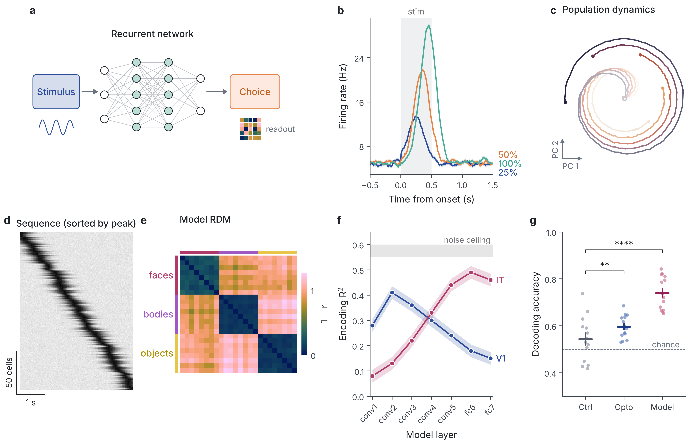
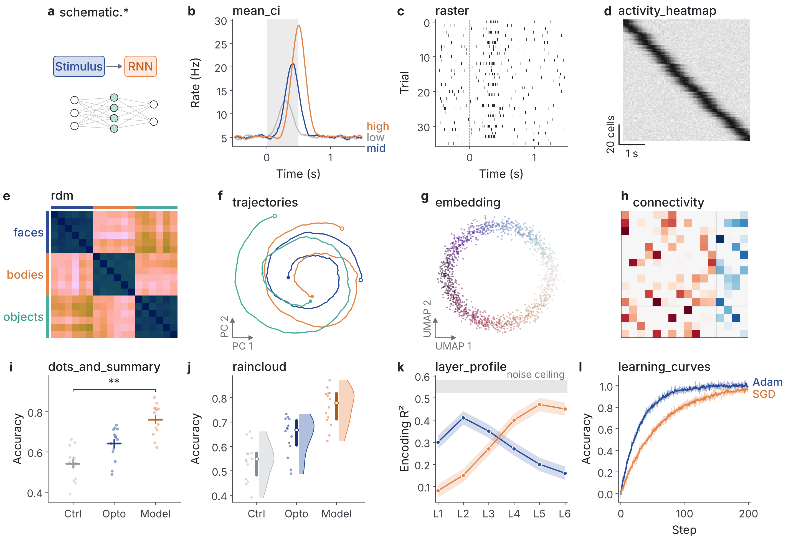
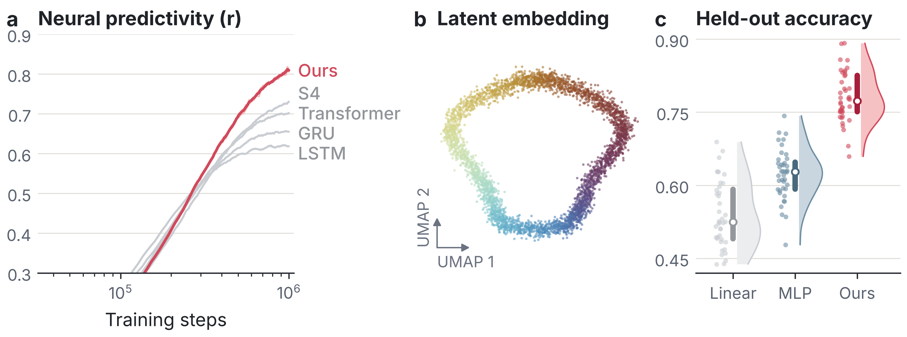
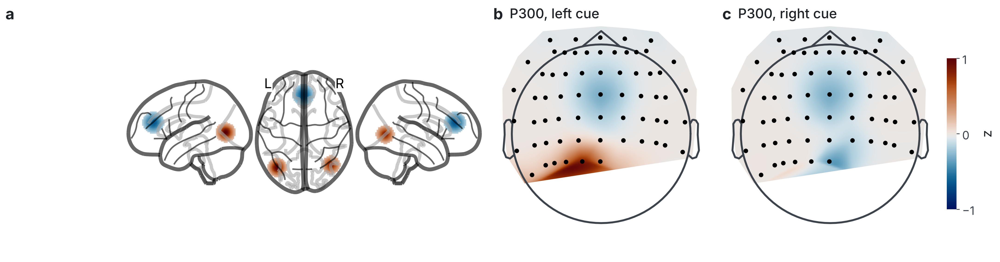
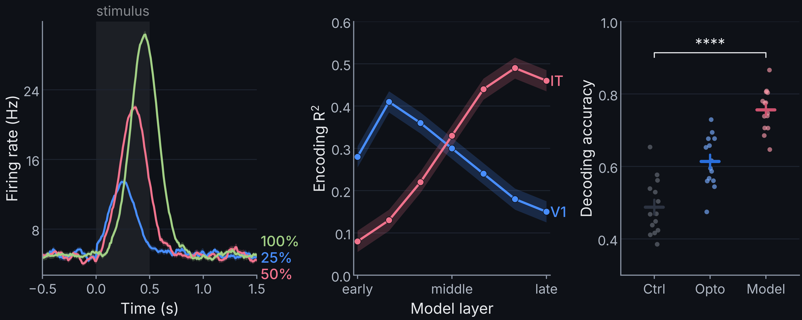
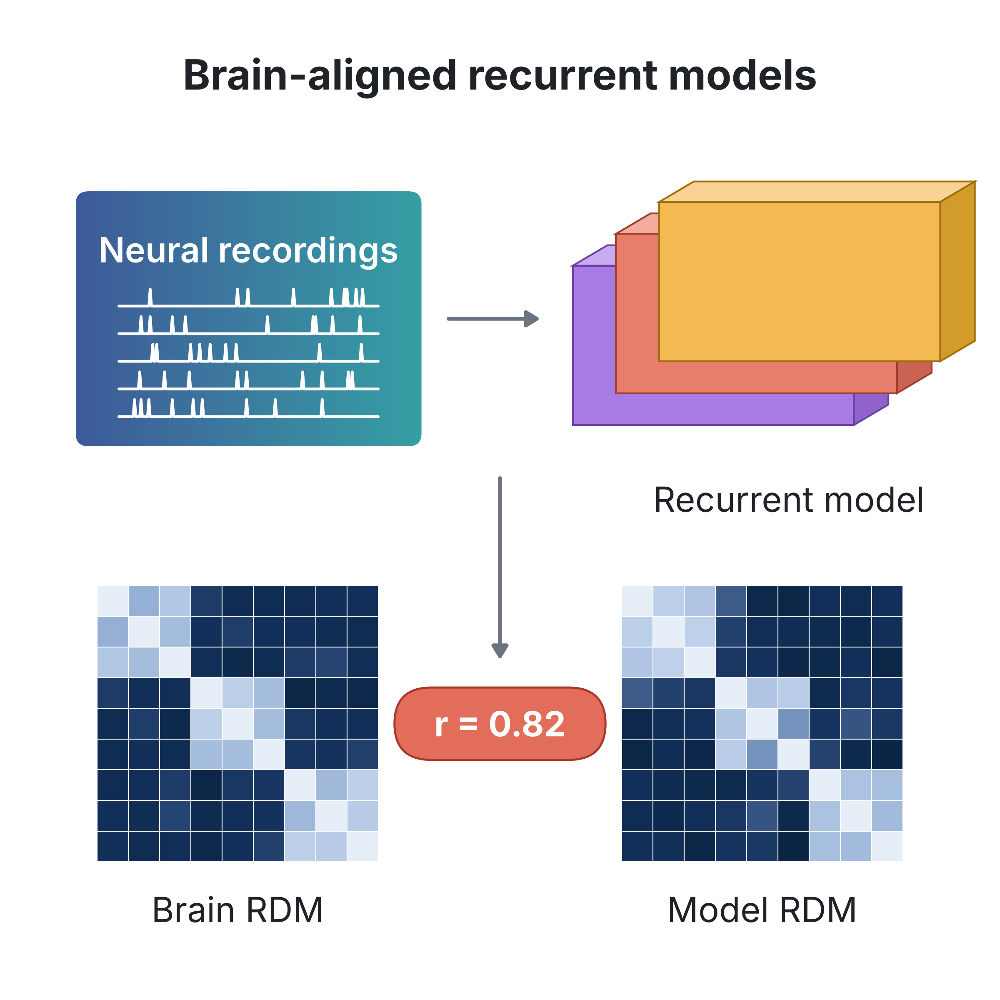
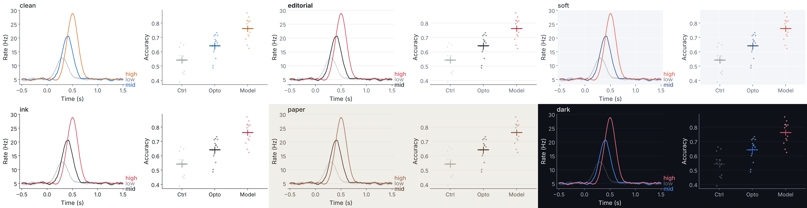

# scientific-figure · publication-grade figures for computational neuroscience & NeuroAI

[](https://github.com/mmd-ahd/scientific-figure-skill/actions/workflows/ci.yml)
[](LICENSE)


A **Claude skill** and a **standalone Python library (`sciplot`)** for making journal-ready figures:
exact Nature / Cell / Science / eLife / PNAS / JNeurosci / PLOS / NeurIPS / ICML layouts, a 197-palette colour
bank measured for colour-vision deficiency, six visual themes, ready-made comp-neuro and NeuroAI panels
(rasters, PSTHs, RDMs, latent trajectories, embeddings, model–brain layer profiles, rainclouds, connectivity,
learning curves, schematics), brain-viz presets for nilearn / MNE / pycortex / PyVista, and a **linter** that checks
fonts, strokes, sizes, colormaps and colour-blind safety before you submit.

Use it by asking Claude for a figure, or `import sciplot` in your own scripts. It's pure matplotlib, so the output
stays editable vector PDF/SVG.



<sub>Rendered by <code>scripts/demo_figures.py</code>: 183 mm Nature double column, 5–7 pt Inter, lint-clean.</sub>

---

## Contents
- [Why](#why) · [Install](#install) · [Use with Claude](#use-with-claude) · [Use from Python](#use-from-python)
- [Gallery](#gallery) · [Venues](#venues) · [Themes](#themes) · [Colour](#colour) · [Quality checks](#quality-checks)
- [Documentation](#documentation) · [FAQ](#faq) · [Citing](#citing) · [License](#license)

## Why
Good neuroscience figures from the IBL Brain-Wide Map, Rastermap, CEBRA and MICrONS papers have a lot in common:
grey for context and colour for signal, one hue per variable kept across the whole paper, thin despined axes, 5–7 pt
sans-serif text, scale bars instead of axes on image-like panels, and every data point shown. Journals add their
own rules on top: column widths in mm, minimum stroke weights, panel-letter case, editable fonts, no red/green.

matplotlib's defaults miss most of these. They give Type-3 fonts, `bbox_inches="tight"` changing your width, the
`tab10` cycle that is not CVD-safe, and DejaVu mathtext. This project applies those rules for you, using the
sources collected in [`references/`](references/research-report.md).

## Install

### Claude Code (CLI, desktop, web)
Clone into your skills folder. The folder name must be `scientific-figure` so it matches the skill name:
```bash
git clone https://github.com/mmd-ahd/scientific-figure-skill ~/.claude/skills/scientific-figure
# project-scoped instead:  git clone … .claude/skills/scientific-figure
```

### claude.ai / Claude desktop app
Download `scientific-figure.zip` from the [latest release](https://github.com/mmd-ahd/scientific-figure-skill/releases)
and upload it under **Settings → Capabilities → Skills**.

### Plain Python (no Claude)
```bash
pip install "git+https://github.com/mmd-ahd/scientific-figure-skill"            # numpy + matplotlib only
pip install "sciplot-neuro[all] @ git+https://github.com/mmd-ahd/scientific-figure-skill"  # + cmcrameri, cmasher, scipy, seaborn, nilearn, mne
```

### Fonts (optional)
The default typeface is [Inter](https://rsms.me/inter/). Without it, sciplot falls back to Helvetica → Arial →
Liberation Sans → DejaVu Sans and tells you which font it used.
```bash
python scripts/install_fonts.py          # installs Inter + JetBrains Mono (OFL) for your user
python scripts/install_fonts.py --list   # shows what matplotlib can see
```

## Use with Claude
Once installed, Claude loads the skill whenever you ask for a figure. Some example prompts:

> *"Make a Nature Neuroscience double-column figure from `results.npz`: a, task schematic; b, PSTHs for the three
> contrasts; c, population trajectories; d, decoding accuracy per mouse vs. shuffle."*

> *"Plot layer-wise encoding R² of ResNet-50 against V1, V4 and IT with the noise ceiling, NeurIPS half-width."*

> *"Make this figure colour-blind safe and Cell-compliant"* (attach your script or PNG)

> *"Turn Figure 2 into a dark 16:9 slide for my lab meeting"* · *"Draw a graphical abstract for this paper."*

The skill makes Claude follow a fixed workflow: state the message of each panel → lay out at the final size → pick
colours by data type → build with recipes → lint → **render the PNG and look at it** → deliver vector + preview,
reporting the font, palette and size used. See [docs/using-with-claude.md](docs/using-with-claude.md).

## Use from Python
```python
import numpy as np
import sciplot as sp
from sciplot import neuro

rng = np.random.default_rng(0)
t = np.linspace(-0.5, 1.5, 200)
ctrl = 5 + rng.normal(0, 1, (30, 200))
opto = ctrl + 8 * np.exp(-((t - 0.3) / 0.15) ** 2)

sp.use("clean", target="nature", palette="sp.neuro")              # theme × venue
pal, tc = sp.colors("sp.neuro"), sp.theme_colors()
fig, ax = sp.figure("nature", "double", height_mm=60, mosaic="AB", width_ratios=[1.4, 1])

neuro.mean_ci(ax["A"], t, ctrl, tc["context"], label="Control")    # grey = context
neuro.mean_ci(ax["A"], t, opto, pal[0], label="Opto")              # colour = signal
sp.shade(ax["A"], 0, 0.5, label="stim"); sp.label_lines(ax["A"])   # direct labels, no legend box
ax["A"].set(xlabel="Time from onset (s)", ylabel="Firing rate (Hz)")

neuro.dots_and_summary(ax["B"], [rng.normal(.55, .08, 12), rng.normal(.7, .08, 12)],
                       [tc["context"], pal[0]], labels=["Ctrl", "Opto"])
sp.sig_bracket(ax["B"], 0, 1, y=0.9, text=0.004)                  # P value → stars
ax["B"].set_ylabel("Decoding accuracy")

sp.label_panels(fig, ax)                                           # a, b in Nature style
sp.save(fig, "figures/fig1", formats=("pdf", "svg", "png"), target="nature")
# lint [nature] — OK
#   font: Inter
# saved fig1.pdf, fig1.svg, fig1.png  [183 x 60 mm]
```
Without installing anything, the matching style files also work in plain matplotlib:
`plt.style.use("styles/clean-nature.mplstyle")`.

## Gallery
| | |
|---|---|
| **Every panel recipe** ([`recipe_gallery.py`](scripts/recipe_gallery.py))  | **NeurIPS editorial**  **Brain-viz presets (nilearn + MNE)**  |
| **Dark talk slide**  | **Graphical abstract** (Cell 1200 px)  |

Panel recipes in `sciplot.neuro`:

| Data | Recipe |
|---|---|
| Trial-averaged responses | `mean_ci` (SEM/SD/bootstrap band), `psth`, `gradient_line` |
| Spikes & populations | `raster`, `activity_heatmap` (Rastermap-style, scale bars) |
| Representations | `rdm` (category blocks, coloured group bars), `connectivity` (E/I split) |
| Latent dynamics | `trajectories` (2-D/3-D, colour by time), `embedding` (UMAP/t-SNE/CEBRA), `axis_arrows`, `style_3d` |
| Statistics | `dots_and_summary`, `raincloud`, `half_violin`, `sig_bracket` |
| NeuroAI | `layer_profile` (model–brain alignment + noise ceiling), `learning_curves` (seeds + mean), `tuning_curve` |
| Brain maps | `nilearn_kwargs`, `mne_topomap_kwargs`, `pycortex_quickflat_kwargs`, `pyvista_theme`, `normalize_text` |
| Schematics (`sciplot.schematic`, mm canvas) | `box`, `pill`, `arrow`, `connect`, `pipeline`, `network`, `recurrent_unit`, `layer_stack`, `prism`, `mini_trace`, `mini_matrix`, `gradient_box`, `bracket` |

Details and snippets: [docs/recipes.md](docs/recipes.md).

## Venues
`sp.figure(target, width)` uses the publisher's column widths in mm and `sp.use(theme, target)` sets the matching
font sizes, stroke weights and panel-letter style.

| Target | Widths (mm) | Text (pt) | Panel letters | Notes |
|---|---|---|---|---|
| `nature` | 89 / 120 / 136 / 183 | 5–7 | **a** 8 pt bold | strokes 0.25–1 pt |
| `nature-research` (`nn`, `nmi`, `nhb`) | 88 / 180 | 5–7 | **a** | |
| `ncomms` | 88 / 180 | 5–7 | **a** 7 pt | lines ≥ 1 pt |
| `cell` (`neuron`, `current-biology`, `cell-reports`) | 85 / 114 / 174 | 6–8 | **A** | Arial only |
| `science` (`science-advances`) | 90 / 144 / 184 | 6–8 | **A** | no minor ticks |
| `elife` | 100 / 200 | 6–10 | **A** | |
| `pnas` | 87 / 114 / 178 | 6–12 | **A** | |
| `jneurosci` | 85 / 116 / 176 | 6–10 | **A** | |
| `plos` (`ploscb`) | 132 / 190.5 | 8–12 | **A** | Arial, TIFF/EPS |
| `neurips` (`iclr`) | 139.7 / 67.5 / 44.5 | 6–10 | **a** | text width 5.5 in |
| `icml` | 82.55 / 171.45 | 6–10 | **a** | |
| `slide`, `poster`, `graphical-abstract`, `web`, `biorxiv` | — | large | — | non-print canvases |

Sources and dates for every value: [references/journal-specs.md](references/journal-specs.md). Publisher guidelines
change, so check the current author instructions before you submit.

## Themes
`clean` (journal default) · `editorial` (FT/Economist-style hairlines) · `soft` (pale panel + white grid) ·
`ink` (monochrome + one accent) · `paper` (warm off-white, for web/posters) · `dark` (slides).



## Colour
- **197 palettes** (152 categorical, 27 sequential, 17 diverging) from Okabe–Ito, Paul Tol, Crameri, IBM Carbon,
  journal styles, editorial newsrooms, art and cinema, plus 21 originals (`sp.*`) tuned in OKLCH.
  Each palette has its CVD ΔE2000 measured and a `safe_n`, the number of colours that stay distinct for
  deutan/protan/tritan viewers.
- **Semantic palettes** keep neuro conventions consistent across figures: `sp.semantic("neuro.ei")`,
  `neuro.lr` (IBL left = blue, right = red), `neuro.opto` (ChR2 blue / ArchT amber), `neuro.split`, `neuro.outcome`,
  `neuro.bands`, `neuro.cortical_layers`, `neuro.cell_class`, `neuro.areas_visual`, `neuro.species`.
- **Search** for a palette: `sp.search(kind="cat", mood="calm", cvd_safe=True, min_n=4)`. Helpers include
  `sp.highlight(n, idx)` (grey + one accent), `sp.shades`, `sp.paired`, and OKLCH colour math in `sp.color`.
- Browse the full catalogue in [references/palettes.md](references/palettes.md) and the
  [palette galleries](assets/).

## Quality checks
`sp.save(...)` runs `sp.check.lint(fig, target)` automatically. It reports:
- figure width that isn't a standard column width, and height over the page limit
- text below or above the venue's size range, and low-contrast text
- lines and spines thinner than the venue's minimum stroke
- categorical colours that become indistinguishable under simulated CVD, and more than 8 hues
- rainbow colormaps (`jet`, `rainbow`, `hsv`, …)
- the font actually rendered, including Arial-only venues rendered in another font and silent DejaVu fallbacks

`save()` always writes TrueType (Type 42) fonts in PDF and live `<text>` in SVG, and never uses
`bbox_inches="tight"` for journal targets.

## Documentation
- [docs/using-with-claude.md](docs/using-with-claude.md): how the skill works, prompts, and fixing an existing figure
- [docs/api.md](docs/api.md): API reference
- [docs/recipes.md](docs/recipes.md): panel recipes with snippets
- [`references/`](references/): design principles, colour science, journal specs, neuro figure patterns, a design
  trend survey, and the full sourced research report (Claude also reads these when it needs them)

## Repository layout
```
SKILL.md                 Claude skill entry point (instructions + API cheat-sheet)
scripts/sciplot/         the library (palettes, color, styles, layout, annotate, neuro, schematic, check, export)
scripts/demo_figures.py  reference figures, doubling as a visual regression test
scripts/recipe_gallery.py, palette_gallery.py, install_fonts.py, tools/
styles/                  42 generated .mplstyle files (6 themes × 7 targets)
references/              design + journal knowledge base
examples/, assets/       rendered figures and palette galleries
tests/                   pytest suite (runs with numpy + matplotlib only)
```

## FAQ
**Do I need Claude?** No. `sciplot` is a normal Python package and the `.mplstyle` files work in plain matplotlib.
The skill adds the workflow and design judgement on top.

**Will it change my data?** No. Recipes only draw. `mean_ci` and `dots_and_summary` compute the summary you ask for
(SEM, SD or bootstrap CI), and the error-bar definition is up to you to state in the legend.

**Seaborn?** Works fine. Call `sns.<plot>(..., ax=ax, palette=sp.colors(name, k))` *after* `sp.use(...)`, and don't
call `sns.set_theme()` afterwards because it overwrites the style.

**Why Inter, not Arial?** Nature *prefers* Helvetica/Arial, and Inter is a neutral grotesque that reads well at 5–7 pt.
For venues that *require* Arial (Cell Press, PLOS), sciplot switches to Arial or Liberation Sans automatically.
Pass `font="arial"` to force it anywhere.

**Missing `cmc.batlow`?** Install `cmcrameri` (`pip install cmcrameri cmasher`). Without it, those names fall back
to matplotlib's viridis / RdBu_r / twilight and you get a warning.

## Contributing
Contributions are welcome: new venues, recipes, palettes and corrections to journal specs.
See [CONTRIBUTING.md](CONTRIBUTING.md).

## Citing
If this helps your paper or talk, please cite it (GitHub's "Cite this repository" button uses
[CITATION.cff](CITATION.cff)):
```bibtex
@software{ahadzadeh_scientific_figure_2026,
  author  = {Ahadzadeh, Mohammad},
  title   = {scientific-figure: publication-grade figures for computational neuroscience and NeuroAI},
  year    = {2026},
  version = {1.0.0},
  url     = {https://github.com/mmd-ahd/scientific-figure-skill}
}
```

## License
[MIT](LICENSE) © 2026 Mohammad Ahadzadeh. Palette data adapted from third-party sources keeps its original
attribution; see [THIRD_PARTY.md](THIRD_PARTY.md). Fonts are not bundled.

## Acknowledgements
Built on [matplotlib](https://matplotlib.org). Colour work draws on Okabe & Ito, Paul Tol, Fabio Crameri's
[Scientific colour maps](https://www.fabiocrameri.ch/colourmaps/), [CMasher](https://cmasher.readthedocs.io),
Petroff's accessible colour sequences, and Machado et al.'s CVD model. Design conventions come from the open plotting
code of the IBL Brain-Wide Map, Rastermap, CEBRA and MICrONS projects, and from the writing of Rougier, Wilke,
Wong, Krzywinski and Weissgerber.
